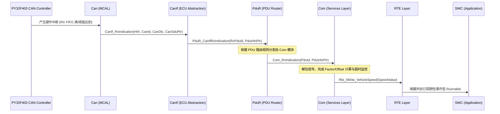

# 汽车电子高级工程师系统进阶指南：CAN/CAN-FD总线通信、AUTOSAR架构与ISO 26262功能安全实战

> **面向对象**：嵌入式软件工程师、汽车电子底层/BSP开发人员、系统集成工程师  
> **工程基准**：基于 普冉 PY32F403 (Arm Cortex-M4 @ 120MHz) CAN-FD 控制器 IP 及车载量产设计实践  
> **文档版本**：v1.0.0  
> **更新日期**：2026-10-20  

---

## 目录
- [0. 汽车电子工程师的认知跃迁](#0-汽车电子工程师的认知跃迁)
- [第一模块：CAN / CAN-FD 总线通信核心技术与实战](#第一模块can--can-fd-总线通信核心技术与实战)
  - [1.1 物理层拓扑与电气特性](#11-物理层拓扑与电气特性)
  - [1.2 报文帧结构：Classic CAN 与 CAN-FD 差异矩阵](#12-报文帧结构classic-can-与-can-fd-差异矩阵)
  - [1.3 位时序与采样点精算（结合 PY32F403 平台）](#13-位时序与采样点精算结合-py32f403-平台)
  - [1.4 非破坏性位仲裁与优先级机制](#14-非破坏性位仲裁与优先级机制)
  - [1.5 错误处理机制与量产级 Bus-Off 快慢恢复策略](#15-错误处理机制与量产级-bus-off-快慢恢复策略)
  - [1.6 车载网络协议栈：DBC、CanTp (ISO 15765-2) 与 UDS (ISO 14229)](#16-车载网络协议栈dbc-cantp-iso-15765-2-与-uds-iso-14229)
- [第二模块：Classic AUTOSAR 汽车软件架构深度解析](#第二模块classic-autosar-汽车软件架构深度解析)
  - [2.1 AUTOSAR 架构哲学与分层解耦体系](#21-autosar-架构哲学与分层解耦体系)
  - [2.2 CAN 通信全栈交互与数据流图谱](#22-can-通信全栈交互与数据流图谱)
  - [2.3 裸机工程（如 PY32F403）向 AUTOSAR 的思维映射](#23-裸机工程如-py32f403-向-autosar-的思维映射)
  - [2.4 AUTOSAR OS 实时操作系统核心调度机制](#24-autosar-os-实时操作系统核心调度机制)
- [第三模块：ISO 26262 道路车辆功能安全标准实操](#第三模块iso-26262-道路车辆功能安全标准实操)
  - [3.1 功能安全核心哲学：系统性失效 vs 随机硬件失效](#31-功能安全核心哲学系统性失效-vs-随机硬件失效)
  - [3.2 概念阶段：HARA 危害分析与 ASIL 定级实务](#32-概念阶段hara-危害分析与-asil-定级实务)
  - [3.3 硬件随机失效率三大硬性量化指标（PMHF, SPFM, LFM）](#33-硬件随机失效率三大硬性量化指标pmhf-spfm-lfm)
  - [3.4 软件阶段安全架构设计（Part 6 & FFI 免于干涉）](#34-软件阶段安全架构设计part-6--ffi-免于干涉)
  - [3.5 车载通信端到端防护：AUTOSAR E2E 保护机制与代码实战](#35-车载通信端到端防护autosar-e2e-保护机制与代码实战)
- [第四模块：汽车电子高级工程师成长路线与工具链图谱](#第四模块汽车电子高级工程师成长路线与工具链图谱)
  - [4.1 核心能力阶梯矩阵](#41-核心能力阶梯矩阵)
  - [4.2 行业标准工具链体系](#42-行业标准工具链体系)
  - [4.3 基于 PY32F403 平台的实操进阶建议](#43-基于-py32f403-平台的实操进阶建议)

---

## 0. 汽车电子工程师的认知跃迁

消费电子与工业单片机开发通常以“外设寄存器配通、功能跑通”为目标；而汽车电子（Automotive Electronics）则受到汽车工业三大基石的严苛约束：
1. **确定性时延与实时性**：必须在严格受限的毫秒级窗口内完成从传感采样、总线通信到执行机构驱动的全链路闭环；
2. **整车生命周期的高可靠性**：汽车工作环境覆盖 $-40^\circ\text{C} \sim +125^\circ\text{C}$，面临强烈振动、电源瞬变电压（ISO 7637 / ISO 16750）、EMC 辐射与高低温漂移；
3. **软件架构的跨平台标准化解耦**：整车数十甚至上百个 ECU（电子控制单元）由数十家 Tier 1 提供，软硬件必须遵循标准体系（AUTOSAR、ISO 26262、ASPICE）实现互操作与功能安全闭环。

成为高级汽车电子工程师，必须完成从**芯片驱动修补者**到**整车电子电气系统架构者**的质变。

---

## 第一模块：CAN / CAN-FD 总线通信核心技术与实战

### 1.1 物理层拓扑与电气特性

CAN（Controller Area Network）物理层采用双绞线差分传输，具有极强的共模噪声抑制能力。

```
 逻辑电平        总线差分状态                   CAN_H / CAN_L 电平示意
---------------------------------------------------------------------------------
  0 (显性)   Vdiff = CAN_H - CAN_L ≈ 2.0V   CAN_H ─── 3.5V (强驱动)
                                            CAN_L ─── 1.5V (线与逻辑胜出)
---------------------------------------------------------------------------------
  1 (隐性)   Vdiff = CAN_H - CAN_L ≈ 0.0V   CAN_H ─── 2.5V (无驱动，电阻拉平)
                                            CAN_L ─── 2.5V
```

#### 关键工程要素
1. **总线拓扑与线与（Wired-AND）逻辑**：
   - 显性电平覆盖隐性电平。只要总线上有一个节点输出显性（0），整条总线即呈现显性；只有所有节点均输出隐性（1），总线才维持隐性。
2. **终端电阻阻抗匹配**：
   - 物理传输线特性阻抗约为 $120\ \Omega$。总线两端各并联一个 $120\ \Omega$ 终端电阻（并联总阻抗 $60\ \Omega$），用于完全吸收高频能量，杜绝信号边沿发生反射与振铃。
   - **分裂终端（Split Termination）**：将每个 $120\ \Omega$ 电阻替换为两个匹配的 $60\ \Omega$ 电阻串联，中心抽头经一个 $4.7\text{ nF}$ 电容接入 GND，形成高频共模低通滤波器，有效降低 CAN-FD（高达 2M~5 Mbps）在高速边沿上的 EMC 辐射。
3. **分支线（Stub Line）限制**：
   - CAN-FD 数据段速率达到 2 Mbps 时，1 bit 宽度仅为 500 ns。信号在 PCB/线缆中的传播速度约为 $5\text{ ns/m}$。
   - 分支线反射波在单 bit 时间内无法衰减完毕将导致位采样失败，因此分支线长度必须严格限制在 $0.3\text{ m}$ 以内，主干线两端务必保证端接。

---

### 1.2 报文帧结构：Classic CAN 与 CAN-FD 差异矩阵

| 对比维度 | Classic CAN (ISO 11898-1:2003) | CAN-FD (ISO 11898-1:2015) | 汽车级设计与工程原因 |
| :--- | :--- | :--- | :--- |
| **最大数据长度** | 8 字节 | **64 字节** | 适应 UDS 固件刷写、ADAS 传感器多维数据包吞吐量需求 |
| **传输速率** | 全帧单一速率（常用 250k / 500 kbps） | **双速率**：仲裁段（500k）+ 数据段（2M~5 Mbps） | 兼顾全网长物理距离仲裁与局部数据传输高速率 |
| **DLC 编码规则** | 0~8 直接对应 0~8 字节 | 0~8 (0~8B), 9 (12B), 10 (16B), 11 (20B), 12 (24B), 13 (32B), 14 (48B), 15 (64B) | 采用非线性查表映射，软件驱动需维护 `DLCtoBytes[]` 映射数组 |
| **控制段新增位** | $r0, r1$ 保留位 | **FDF** (FD Format), **BRS** (Bit Rate Switch), **ESI** (Error State Indicator) | ESI 由硬件实时广播自身是否进入 Error Passive 状态；BRS 决定数据段是否提速 |
| **CRC 校验字段** | 15 位 CRC | **17 位** ($\le 16\text{B}$) / **21 位** ($> 16\text{B}$) + **Stuff Count（填充计数）** | 加入 Stuff Count 彻底杜绝了级联位填充导致的汉明距离（Hamming Distance）恶化缺陷 |
| **发送延迟补偿** | 不支持 | **TDC**（Transmitter Delay Compensation）+ **SSP**（二次采样点） | 数据段超过 1 Mbps 时，收发器回路延时大于单 bit 宽度，必须由硬件 TDC 补偿 |

---

### 1.3 位时序与采样点精算（结合 PY32F403 平台）

每个 CAN 位时间（Bit Time）由 4 个时间段构成，单位为时间微元 $t_q$（Time Quantum）：

$$\text{Bit Time} = \text{Sync\_Seg} + \text{Prop\_Seg} + \text{Phase\_Seg1} + \text{Phase\_Seg2}$$

在普冉 PY32F403 HAL 库及多数车载微控制器中，$\text{Prop\_Seg}$ 与 $\text{Phase\_Seg1}$ 合并为 $\text{TimeSeg1}$：
- $\text{Sync\_Seg} = 1\ t_q$（硬件同步硬性规定，固定为 1）
- $\text{Bit Time} = (1 + \text{TimeSeg1} + \text{TimeSeg2}) \times t_q$
- $t_q = \frac{\text{Prescaler}}{f_{CAN\_CLK}}$
- **采样点位置（Sample Point, SP）** 计算公式：

$$\text{Sample Point (\%)} = \frac{1 + \text{TimeSeg1}}{1 + \text{TimeSeg1} + \text{TimeSeg2}} \times 100\%$$

#### 车载工程规范要求
- **仲裁段采样点**：推荐处于 **$80.0\% \sim 85.0\%$**；
- **数据段采样点**：推荐处于 **$75.0\% \sim 80.0\%$**；
- **同步跳转宽度（SJW）**：用于吸收节点间晶振温漂与相位误差，一般配置为 $\min(\text{TimeSeg2}, 4\ t_q)$。

#### PY32F403 平台计算实战（$f_{CAN\_CLK} = 20\text{ MHz}, t_q = 50\text{ ns}$）

1. **仲裁段：标称 500 kbps**
   - 单位时间：$\text{Bit Time} = \frac{1}{500\text{ kbps}} = 2000\text{ ns} = 40\ t_q$
   - 设定：$\text{Prescaler} = 1$
   - 选取：$\text{TimeSeg1} = 31$, $\text{TimeSeg2} = 8$
   - 验证采样点：$\frac{1 + 31}{40} \times 100\% = 80.0\%$
   - 配置：$\text{NominalSyncJumpWidth} = 8$

2. **数据段：标称 2 Mbps**
   - 单位时间：$\text{Bit Time} = \frac{1}{2\text{ Mbps}} = 500\text{ ns} = 10\ t_q$
   - 设定：$\text{Prescaler} = 1$
   - 选取：$\text{TimeSeg1} = 7$, $\text{TimeSeg2} = 2$
   - 验证采样点：$\frac{1 + 7}{10} \times 100\% = 80.0\%$
   - 配置：$\text{DataSyncJumpWidth} = 2$

```c
/* PY32F403 车载标准精确位时序配置源码片段 (Allman Style) */
CanfdHandle.Instance                     = CANFD;
CanfdHandle.Init.FrameFormat             = CANFD_FRAME_FD_BRS;
CanfdHandle.Init.Mode                    = CANFD_MODE_NORMAL;
CanfdHandle.Init.CANFDProtocol           = CANFD_FD_ISO_11898;
CanfdHandle.Init.Prescaler               = 1U;

/* 仲裁段：500 kbps, 采样点 80.0% */
CanfdHandle.Init.NominalSyncJumpWidth    = 8U;
CanfdHandle.Init.NominalTimeSeg1         = 31U;
CanfdHandle.Init.NominalTimeSeg2         = 8U;

/* 数据段：2 Mbps, 采样点 80.0% */
CanfdHandle.Init.DataSyncJumpWidth       = 2U;
CanfdHandle.Init.DataTimeSeg1            = 7U;
CanfdHandle.Init.DataTimeSeg2            = 2U;
CanfdHandle.Init.SecondSamplePointOffset = 0U;
```

---

### 1.4 非破坏性位仲裁与优先级机制

1. **仲裁机制**：
   - 当多个节点在总线空闲后同时发送报文时，在仲裁段（SOF + 标识符 ID + RTR/RRS），每个节点在发送每一个 bit 的同时，通过回环监听引脚采样总线真实电平。
   - 若某节点发送**隐性（1）**，但在总线上采样到**显性（0）**，表明有更高优先级的报文正在竞争总线。该节点立即主动退出发送，转入被动接收监听状态，且不触发任何错误帧。
2. **优先级规则**：
   - 标识符数值越小，显性位（0）出现越早，**优先级越高**；
   - 标准帧（11 位 ID）优先级天然高于同 ID 数值的扩展帧（29 位 ID），这是由控制位 IDE（标准帧为显性 0，扩展帧为隐性 1）在仲裁段中的位置所决定的。

---

### 1.5 错误处理机制与量产级 Bus-Off 快慢恢复策略

CAN 节点硬件内部维护两个计数器：**TEC（发送错误计数器）** 与 **REC（接收错误计数器）**。根据计数值不同，节点在三种状态间流转：

```
       [ 主动错误 (Error Active) ] ── (TEC <= 127 且 REC <= 127)
                   │
                   ▼ (连续发送/接收出错，TEC +8 / REC +1)
       [ 被动错误 (Error Passive) ] ── (TEC > 127 或 REC > 127)
                   │ (只能发送隐性错误帧；发帧前强制等待 Suspend Transmission 8 bit)
                   ▼ (故障持续累加，TEC > 255)
       [ 总线关闭 (Bus-Off) ] ── 硬件强制切断 TX 发送驱动，物理隔离故障节点
```

#### 常见 5 种错误类型
- **位错误（Bit Error）**：发出的电平与采样回读的电平不一致（仲裁段与 ACK 槽除外）；
- **填充错误（Stuff Error）**：在连续 5 个相同电平位后未检测到反转电平；
- **CRC 错误（CRC Error）**：接收端校验计算值与报文中接收到的 CRC 序列不符；
- **格式错误（Form Error）**：固定格式位（如 CRC 定界符、ACK 定界符、EOF）检测到非法电平；
- **应答错误（ACK Error）**：发送节点在 ACK 槽发出隐性位，未收到任何其他节点拉低显性确认。

#### 汽车级 Bus-Off 快慢恢复算法（量产必须）
严禁在进入 Bus-Off 后立刻强行软件复位重连总线，否则若为硬件硬短路，会导致整车总线持续处于高负荷冲击或雪崩状态。汽车级恢复机制必须采用**快慢恢复机制（Fast/Slow Recovery）**：

```c
typedef enum
{
    BUSOFF_STATE_ACTIVE = 0,        /**< Controller operating normally */
    BUSOFF_STATE_FAST_RECOVERY,     /**< Fast recovery phase (e.g. 50~100ms) */
    BUSOFF_STATE_SLOW_RECOVERY      /**< Slow recovery phase (e.g. 1000ms) */
} BusOff_RecoveryState_t;

/**
 * @brief  Automotive grade Bus-Off Fast/Slow Recovery Handler.
 * @note   Called periodically from a 10ms system task.
 * @param  pBusState Pointer to the persistent Bus-Off tracking context.
 */
void CAN_BusOff_Task_10ms(BusOff_RecoveryState_t *pBusState)
{
    static uint16_t timer_ms = 0;
    static uint8_t  fast_recovery_count = 0;

    /* Check if hardware controller is in Bus-Off state */
    if (HAL_CANFD_IsBusOff(&CanfdHandle))
    {
        timer_ms += 10U;

        if (pBusState->state == BUSOFF_STATE_ACTIVE)
        {
            pBusState->state = BUSOFF_STATE_FAST_RECOVERY;
            timer_ms = 0U;
            fast_recovery_count = 0U;
        }

        if (pBusState->state == BUSOFF_STATE_FAST_RECOVERY)
        {
            /* Fast recovery interval: 100ms, max 5 attempts */
            if (timer_ms >= 100U)
            {
                timer_ms = 0U;
                fast_recovery_count++;

                HAL_CANFD_Stop(&CanfdHandle);
                HAL_CANFD_Start(&CanfdHandle); /* Re-initialize peripheral registers */

                if (fast_recovery_count >= 5U)
                {
                    /* Exhausted fast retries; switch to slow recovery */
                    pBusState->state = BUSOFF_STATE_SLOW_RECOVERY;
                }
            }
        }
        else if (pBusState->state == BUSOFF_STATE_SLOW_RECOVERY)
        {
            /* Slow recovery interval: 1000ms retry to prevent bus flooding */
            if (timer_ms >= 1000U)
            {
                timer_ms = 0U;
                HAL_CANFD_Stop(&CanfdHandle);
                HAL_CANFD_Start(&CanfdHandle);
            }
        }
    }
    else
    {
        /* Bus returned to active state: reset tracker */
        pBusState->state = BUSOFF_STATE_ACTIVE;
        timer_ms = 0U;
        fast_recovery_count = 0U;
    }
}
```

---

### 1.6 车载网络协议栈：DBC、CanTp (ISO 15765-2) 与 UDS (ISO 14229)

1. **DBC 数据库规范**：
   - 定义报文 ID、周期、长度，以及每个信号（Signal）的起始位、位宽、字节序（**Intel 小端**：跨字节从低字节向高字节排布；**Motorola 大端**：跨字节高位先发）、物理值转换公式：

$$\text{Physical Value} = \text{Raw Value} \times \text{Factor} + \text{Offset}$$

2. **ISO 15765-2 网络传输层（CanTp）**：
   - 解决经典 CAN 8 字节限制与长数据包传输之间的矛盾，定义 4 种传输层协议数据单元（N-PDU）：
     - **SF（Single Frame）**：单帧，承载数据 $\le 7\text{ B}$（CAN-FD 最高可达 62 字节）；
     - **FF（First Frame）**：首帧，携带完整报文总字节长度，接收端据此准备缓存；
     - **FC（Flow Control）**：流控帧，包含 $\text{FS}$（流控状态：0-CTS 继续发送, 1-WAIT 等待, 2-OVFL 溢出）、$\text{BS}$（块大小 Block Size）、$\text{STmin}$（连续帧最小间隔时间）；
     - **CF（Consecutive Frame）**：连续帧，包含 4 位滚动序号（$SN = 1 \sim 15$ 循环），用于拼接并监控顺序丢失。
3. **ISO 14229 统一诊断服务（UDS on CAN）**：
   - 汽车售后维修、下线检测（EOL）与 Bootloader 刷写的标准语言：
     - `$10`：诊断会话控制（Default, Programming, Extended Session）；
     - `$27`：安全访问（Seed & Key 非对称加密与解密认证）；
     - `$22 / $2E`：按 DID（Data Identifier）读写系统数据（VIN 码、标定参数、传感器电压）；
     - `$19`：故障代码读取（DTC 状态掩码、冻结帧 Freeze Frame、扩展数据）；
     - `$31`：例程控制（驱动电机自转测试、擦除 Flash 片区）；
     - `$34 / $36 / $37`：固件在线升级三部曲（请求下载、数据块传输、请求退出传输）。

---

## 第二模块：Classic AUTOSAR 汽车软件架构深度解析

### 2.1 AUTOSAR 架构哲学与分层解耦体系

AUTOSAR（AUTomotive Open System ARchitecture）旨在通过分层标准化软件架构，打破应用程序对特定芯片硬件与编译器的强耦合。

```
┌─────────────────────────────────────────────────────────────────┐
│                  Application Layer (SWC 软件组件)                │
│       [Engine_Speed_SWC]     [Brake_Control_SWC]    [Door_SWC]  │
├─────────────────────────────────────────────────────────────────┤
│                  RTE (Runtime Environment 运行时环境)            │
│       (虚拟功能总线 VFB 的本地实现，通过标准接口隔离 SWC 与底层)          │
├─────────────────────────────────────────────────────────────────┤
│                  BSW (Basic Software 基础软件层)                 │
│  ┌───────────────────────────────────────────────────────────┐  │
│  │ Services Layer (系统服务层)                                │  │
│  │   [OS]    [Com (信号交互)]    [Dcm/Dem (诊断/故障)]  [BswM]  │  │
│  ├───────────────────────────────────────────────────────────┤  │
│  │ ECU Abstraction Layer (ECU 抽象层)                         │  │
│  │   [PduR (PDU路由)]     [CanIf (CAN接口)]     [CanTp]      │  │
│  ├───────────────────────────────────────────────────────────┤  │
│  │ MCAL Layer (微控制器抽象层)                                │  │
│  │   [Can Driver]     [Mcu]     [Port/Dio]     [Gpt]         │  │
│  └───────────────────────────────────────────────────────────┘  │
├─────────────────────────────────────────────────────────────────┤
│                   Hardware (如 PY32F403 微控制器硬件)            │
└─────────────────────────────────────────────────────────────────┘
```

#### 核心解耦理念
- **应用软件组件（SWC）** 完全独立于单片机型号与外设驱动。SWC 内部只能调用由 RTE 生成的 `Rte_Read` / `Rte_Write` 函数。
- 当更换主控芯片（例如从 PY32F403 切换到 NXP S32K3 或 Infineon Aurix TC387）时，**所有的 SWC、RTE 配置、Com、Dcm、Dem 业务逻辑原封不动**，仅仅只需要替换或重新配置最底层的 **MCAL** 驱动代码。

---

### 2.2 CAN 通信全栈交互与数据流图谱

当带有车速信息的 CAN 报文进入微控制器时，数据自底向上的传递路径如下：



- **Can (MCAL)**：只负责操作硬件 Mailbox / FIFO 寄存器，提供统一的 `Can_Write()` 接口与中断服务例程，将中断数据打包为 `Can_HwHandleType`。
- **CanIf (CAN Interface)**：屏蔽多控制器硬件差异，负责硬件接收句柄（HRH）与发送句柄（HTH）向抽象 PDU ID 的映射，处理 Bus-Off 状态回调与收发使能控制。
- **PduR (PDU Router)**：I-PDU 路由枢纽。若是普通广播通信报文，路由给 `Com`；若是诊断多帧报文（CanId 为诊断地址），路由给 `CanTp`。
- **Com (Communication)**：负责“信号”（Signal）到“协议数据单元”（I-PDU）的打包与解包。支持循环发送、事件触发发送、超时监控（Timeout Deadline Monitoring，若发动机报文超过 500 ms 未到达，置位无效标志并上报 Dem 故障）。

---

### 2.3 裸机工程（如 PY32F403）向 AUTOSAR 的思维映射

| 裸机项目实现 (`PY32F403_STK`) | AUTOSAR 工业级标准实现 | 跃迁关键点 |
| :--- | :--- | :--- |
| `main()` 中裸写 `HAL_CANFD_Init()` 配置时钟、位时序 | MCAL `Can_Init(&Can_Config)` | 配置全部解耦为外部工具（DaVinci / EB Tresos）生成的静态常量表 |
| `HAL_CANFD_AddMessageToTxFifo()` 手动填入 64 字节数组 | `Com_SendSignal(SignalId, &value)` | 应用层只需赋值业务物理变量（如 `speed = 2500`），无需关心报文 ID 与位段排布 |
| `main.c` 主循环 `while(1)` 内 `HAL_GetTick()` 轮询发送 | AUTOSAR OS 周期调度 Task（10ms Task 中执行 `Com_MainFunction_Tx()`） | 严苛的时间确定性，消除 `while(1)` 的偶发时延不可控 |
| 中断处理函数 `CAN_IRQHandler()` 直接调用 `printf` | MCAL ISR 只做数据提取和清除标志位，调用 `CanIf_RxIndication()` | 中断禁止阻塞、禁止高开销 IO 操作，遵循最小执行时间原则 |

---

### 2.4 AUTOSAR OS 实时操作系统核心调度机制

AUTOSAR OS 基于 OSEK/VDX 规范演进，专为硬实时（Hard Real-Time）汽车控制设计：
1. **任务分类**：
   - **基本任务（Basic Task）**：只在执行完毕或被高优先级抢占时释放 CPU，无阻塞挂起状态（无 `WaitEvent`），执行效率极高；
   - **扩展任务（Extended Task）**：支持基于 `WaitEvent()` 的挂起等待机制，适合处理异步通信与复杂事件驱动。
2. **天花板优先级协议（PCP, Priority Ceiling Protocol）**：
   - 彻底解决传统嵌入式 RTOS 中的**优先级反转（Priority Inversion）**与**死锁（Deadlock）**问题。当任务获取互斥信号量时，系统将其优先级瞬间提升至该资源设定的最高天花板优先级。
3. **时钟告警与调度表（Alarm & Schedule Table）**：
   - 严禁在工程中随意创建大量不同周期的软定时器；系统统一使用 1ms 硬件定时器作为 Counter，派生出 5ms、10ms、20ms、100ms 周期任务调度表，严格打散任务执行相位（Phase Shift），防止所有周期任务在同一时刻扎堆导致 CPU 负载峰值突刺。

---

## 第三模块：ISO 26262 道路车辆功能安全标准实操

### 3.1 功能安全核心哲学：系统性失效 vs 随机硬件失效

ISO 26262 解决的是由于电气/电子（E/E）系统失控故障引发的不可接受人身伤害风险：
- **系统性失效（Systematic Fault）**：由于软件 Bug、需求漏洞、流程不合规引起的确定性故障。
  - **对策**：全流程遵循 V 模型开发、双向追溯性（Traceability）、严格遵循 MISRA C 静态分析规范与单元/集成测试。
- **随机硬件失效（Random Hardware Fault）**：芯片在运行生命周期中，由于高低温应力老化、电应力漂移、宇宙射线单粒子翻转（SEU）导致的随机物理损坏。
  - **对策**：设计内部与外部硬件安全机制（Lockstep 双核锁步、RAM/Flash ECC 校验、独立硬件看门狗、时钟及电源电压监控）。

---

### 3.2 概念阶段：HARA 危害分析与 ASIL 定级实务

在系统方案设计初始，必须针对功能定义（Item Definition）展开**危害分析与风险评估（HARA）**，推导汽车安全完整性等级（ASIL, Automotive Safety Integrity Level）：

$$\text{ASIL 等级} = f(\text{Severity (严重度)}, \text{Exposure (暴露率)}, \text{Controllability (可控度)})$$

```
                           严重度 (Severity)
              S1 (轻微伤害)        S2 (严重伤害)        S3 (生命危险)
-----------------------------------------------------------------------
E1 (极低概率)       QM                  QM                  QM
E2 (低概率)         QM                  QM                 ASIL A
E3 (中概率)         QM                ASIL A               ASIL B
E4 (高概率)        ASIL A             ASIL B               ASIL D (最高等级)
(注：可控度从一般驾驶员完全可控 C1 至不可控 C3 递进，C 越低，最终定级越低)
```

- **安全目标（Safety Goal, SG）**：针对最高风险场景制定。例如“防止高速巡航时电子驻车制动（EPB）意外锁死”，定级为 **ASIL D**。
- **安全状态（Safe State）**：发生故障后系统必须转入的受控状态（例如 EPB 驱动断电、电机扭矩归零）。
- **容错时间间隔（FTTI, Fault Tolerant Time Interval）**：从硬件故障发生到系统演化为实际危险状态之间的物理时间窗口（例如转向失控 FTTI $\le 50\text{ ms}$）。安全机制必须在 $\text{FTTI}$ 内完成“故障检测 + 故障确认 + 切换至安全状态”。

---

### 3.3 硬件随机失效率三大硬性量化指标（PMHF, SPFM, LFM）

在进行硬件选型与系统 FMEDA（失效模式、影响及诊断分析）分析时，必须满足 ISO 26262 Part 5 强制量化门槛：

| 评估指标 | 含义定义 | ASIL B | ASIL C | ASIL D |
| :--- | :--- | :--- | :--- | :--- |
| **PMHF** | 随机硬件失效率（每小时失效率，以 FIT 计：$1\text{ FIT} = 10^{-9}\text{ failures/h}$） | $< 100\text{ FIT}$ | $< 100\text{ FIT}$ | **$< 10\text{ FIT}$** |
| **SPFM** | 单点故障度量（Single-Point Fault Metric，安全机制对直接导致违背安全目标的覆盖率） | $\ge 90\%$ | $\ge 90\%$ | **$\ge 99\%$** |
| **LFM** | 潜伏故障度量（Latent-Fault Metric，对多点未暴露潜伏故障的安全机制覆盖率） | $\ge 60\%$ | $\ge 60\%$ | **$\ge 90\%$** |

---

### 3.4 软件阶段安全架构设计（Part 6 & FFI 免于干涉）

1. **免于干涉原则（FFI, Freedom From Interference）**：
   - 当同一个微控制器上同时部署 ASIL D 模块（如刹车控制）与 QM 模块（如仪表蓝牙显示）时，必须通过硬件 MPU（内存保护单元）实现物理隔离，防止 QM 模块的野指针越界写入篡改 ASIL D 模块的关键变量或控制寄存器。
2. **看门狗安全管理器（WdgM）三层立体监督**：
   - **活跃性监督（Alive Supervision）**：检查周期性任务执行频次是否正常（既不能漏跑，也不能过快空转）；
   - **死区与执行时间监督（Deadline Supervision）**：检查从事件触发到处理完毕的时钟耗时是否超过阈值；
   - **逻辑流监督（Logical Supervision）**：在核心业务逻辑关键节点埋设 Checkpoint，校验程序执行路径顺序是否与设定的有向图状态机严格一致，杜绝程序受扰跑飞跳过关键安全校验。

---

### 3.5 车载通信端到端防护：AUTOSAR E2E 保护机制与代码实战

由于 CAN 物理层仲裁、网关路由转发可能发生报文丢失、乱序、卡死重复或位跳变，ISO 26262 系统强制要求在应用层数据载荷中加入 **E2E (End-to-End)** 保护字段（典型的 **E2E Profile 1**）：
- **Counter（4-bit 或 8-bit 滚动计数器）**：防止报文丢失、乱序与卡死重放；
- **Data ID（隐藏于校验计算中的 16-bit 专属常量）**：防止网关路由混淆串帧；
- **CRC 校验字段**：覆盖载荷数据与 Data ID。

```c
/* 量产级 E2E 校验器工程实现 (Allman Style, 满足 MISRA C:2012 约束) */

/**
 * @brief E2E Profile 1 接收端状态跟踪结构体
 */
typedef struct
{
    uint8_t  lastCounter;   /**< 上一次成功接收的滚动计数器数值 */
    uint32_t errorCount;    /**< 累计通信异常帧计数器 */
} E2E_P01_ProtectState_t;

/**
 * @brief  计算 SAE J1850 标准 CRC-8 校验值
 * @param  pData   待校验数据指针
 * @param  length  数据长度 (字节)
 * @param  dataId  预分配的唯一 Data ID
 * @retval 计算得到的 CRC-8 数值
 */
static uint8_t E2E_CalculateCRC8(const uint8_t *pData, uint32_t length, uint16_t dataId)
{
    uint8_t crc = 0xFFU;
    uint32_t i;
    uint32_t j;

    /* 将 Data ID 低字节与高字节纳入 CRC 计算 */
    uint8_t idLow = (uint8_t)(dataId & 0x00FFU);
    uint8_t idHigh = (uint8_t)((dataId >> 8U) & 0x00FFU);

    crc ^= idLow;
    for (j = 0U; j < 8U; j++)
    {
        if ((crc & 0x80U) != 0U)
        {
            crc = (uint8_t)((crc << 1U) ^ 0x1DU); /* Polynomial: 0x1D */
        }
        else
        {
            crc <<= 1U;
        }
    }

    crc ^= idHigh;
    for (j = 0U; j < 8U; j++)
    {
        if ((crc & 0x80U) != 0U)
        {
            crc = (uint8_t)((crc << 1U) ^ 0x1DU);
        }
        else
        {
            crc <<= 1U;
        }
    }

    /* 逐字节计算 Payload 数据 */
    for (i = 0U; i < length; i++)
    {
        crc ^= pData[i];
        for (j = 0U; j < 8U; j++)
        {
            if ((crc & 0x80U) != 0U)
            {
                crc = (uint8_t)((crc << 1U) ^ 0x1DU);
            }
            else
            {
                crc <<= 1U;
            }
        }
    }

    return (uint8_t)(crc ^ 0xFFU);
}

/**
 * @brief  校验接收到的关键安全报文 E2E 完整性
 * @param  pPayload 接收到的原始报文缓冲 (Byte 0 为 CRC, Byte 1 低 4 位为 Counter)
 * @param  length   报文总字节长度
 * @param  dataId   静态绑定的 Data ID
 * @param  pState   指向接收端状态跟踪结构体的指针
 * @retval 0: 校验通过; -1: 指针或长度错误; -2: 重复帧; -3: CRC 损坏
 */
int32_t E2E_Profile01_Check(const uint8_t *pPayload, uint8_t length, uint16_t dataId, E2E_P01_ProtectState_t *pState)
{
    uint8_t receivedCrc;
    uint8_t calculatedCrc;
    uint8_t currentCounter;

    if ((pPayload == NULL) || (pState == NULL) || (length < 2U))
    {
        return -1;
    }

    receivedCrc    = pPayload[0];
    currentCounter = (uint8_t)(pPayload[1] & 0x0FU);

    /* 1. 滚动计数器检验：杜绝死卡与重复帧 */
    if (currentCounter == pState->lastCounter)
    {
        pState->errorCount++;
        return -2; /* 检测到重放/卡死重复帧，坚决丢弃 */
    }

    /* 2. 计算并比对 CRC */
    calculatedCrc = E2E_CalculateCRC8(&pPayload[1], (uint32_t)length - 1U, dataId);
    if (calculatedCrc != receivedCrc)
    {
        pState->errorCount++;
        return -3; /* 数据已被总线物理干扰篡改，安全拦截 */
    }

    /* 校验完全通过，更新追踪状态 */
    pState->lastCounter = currentCounter;
    return 0;
}
```

---

## 第四模块：汽车电子高级工程师成长路线与工具链图谱

### 4.1 核心能力阶梯矩阵

```
  资深汽车电子系统架构师 / Technical Lead
  ▲  整车 EEA 拓扑规划、ISO 26262 流程体系建立、功能安全技术安全概念 (TSC) 评审
  │
  AUTOSAR 基础软件 (BSW) 与系统集成专家
  ▲  精通 Vector DaVinci / EB Tresos 配置、Com/Dcm/Dem/CanTp 协议栈定制与故障排查
  │
  底层驱动 (BSP) 与车载协议栈工程师 (基于当前 PY32F403 阶段)
  ▲  精通 CANFD 控制器 IP、精准位时序计算、Bus-Off 自愈、中断/FIFO 机制与 UDS 诊断
  │
  传统消费类单片机开发者 (初始起点)
```

---

### 4.2 行业标准工具链体系

汽车电子开发严重依赖高度工业化的测试与配置工具链：

1. **总线监控与仿真测试**：
   - **Vector CANoe / CANalyzer**：行业事实标准，用于总线负载监控、CAPL 脚本自动化测试、全网残余总线仿真（Rest-bus Simulation）；
   - **PCAN-Explorer / Kvaser CanKing**：高性价比外场排故与日志记录工具。
2. **AUTOSAR 配置与代码生成**：
   - **Vector DaVinci Configurator / Developer**：主流 OEM / Tier 1 核心软件栈配置环境；
   - **Elektrobit (EB) tresos Studio**：广泛用于欧洲系及主流主控芯片的 MCAL / BSW 基础配置；
   - **ETAS ISOLAR-A / ISOLAR-B**：博世系标准 AUTOSAR 架构与集成环境。
3. **固件标定与测量**：
   - **Vector CANape / ETAS INCA**：基于 XCP on CAN / CCP 协议进行控制算法核心参数在线实时标定与大吞吐量波形监控。
4. **底层调试与代码静态分析**：
   - **Lauterbach TRACE32**：汽车级芯片底层 HardFault、死锁、OS 任务切换开销与指令级硬件断点追踪神器；
   - **Axivion / Polyspace / Helix QAC**：MISRA C:2012 / MISRA C:2023 及功能安全静态代码合规扫描工具。

---

### 4.3 基于 PY32F403 平台的实操进阶建议

立足当前工程，建议按照以下阶段推进实践，完成能力蜕变：

- [ ] **Phase 1：物理层与时序验证（1~2 周）**
  - 使用示波器或逻辑分析仪接入 `CANFD_3Node_Demo` 的 PA11(RX) / PA12(TX) 引脚；
  - 实测仲裁段 $2.0\ \mu\text{s}$ 与数据段 $0.5\ \mu\text{s}$ 电平宽度，观察 80% 采样点位置；
  - 尝试制造物理线短路，观察外设 TEC/REC 计数变化与进入 Bus-Off 的全过程。
- [ ] **Phase 2：编写车载级基础协议栈（3~4 周）**
  - 在现有裸机工程上实现 **Bus-Off 快慢恢复状态机**；
  - 手写实现一个精简的 **CanTp 状态机**（支持首帧 FF、连续帧 CF 接收重组与流控帧 FC 回复）；
  - 在 CanTp 之上搭建简易 **UDS 诊断服务**（支持 `$10` 会话切换、`$22` 读版本 DID、`$27` 伪随机种子密钥安全访问）。
- [ ] **Phase 3：引入 ISO 26262 软件防御机制（2~3 周）**
  - 为 `CANFD_3Node_Demo` 的三节点周期报文增加 **AUTOSAR E2E Profile 1（CRC8 + 滚动计数器）** 防护；
  - 人为注入错序帧、重复帧与数据篡改，验证接收端安全拦截与 Dem 故障打标。
- [ ] **Phase 4：向标准 AUTOSAR 进阶（2~3 个月）**
  - 下载开源 Classic AUTOSAR 实现（如 **ArcCore Arctic Core** 或 **OpenSAR**）；
  - 研读其 `CanIf`、`PduR`、`Com` 模块实现源码，对比其与你在 PY32F403 上裸机实现的架构异同，完成向真正汽车电子架构师的思维蜕变。
